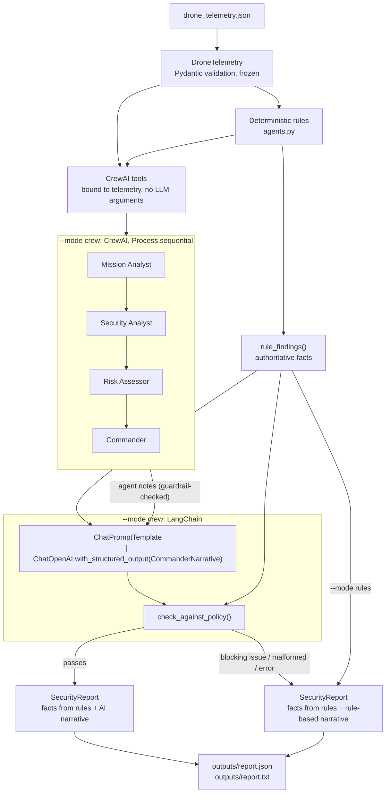

# Multi-Agent Drone Security Analyst

[](https://github.com/Danyy41/multi-agent-drone-security-analyst/actions/workflows/drone-security.yml)

A multi-agent system that analyzes drone telemetry for security and operational threats, such as GPS jamming, and produces a structured security report. Four **CrewAI** agents investigate the telemetry using deterministic detection rules exposed as tools. A **LangChain** structured-output pipeline then writes the commander's narrative.

The system is built around one principle: **the LLM may explain the facts, but it never gets to set them.** Risk scores, threat detections and the safety decision always come from deterministic Python rules. Any AI recommendation that contradicts them is detected and rejected.

> **Verification status:** The CrewAI and LangChain integrations have been tested **only with mocked LLM responses** (scripted fake models). No live OpenAI inference has been run against this version of the code. Live behaviour, latency and cost with a real model are not yet verified. The deterministic rules mode is fully verified, both in tests and in CI.

---

## Architecture



### Components

| File | Responsibility |
|---|---|
| `agents.py` | The original deterministic detection rules: battery check, threat detection (GPS jamming, GPS instability, weak signal), risk scoring and command policy. Unchanged from the original project. |
| `telemetry.py` | `DroneTelemetry` Pydantic model. Validates ranges and types, uses strict booleans for `possible_jamming`, and is frozen after validation. |
| `tools.py` | Four CrewAI `BaseTool`s wrapping the rules, plus `rule_findings()`, the single source of truth for facts. |
| `crew.py` | The four CrewAI agents and their sequential tasks, with guardrails. |
| `report_chain.py` | The LangChain report pipeline, the `SecurityReport` schema and the policy contradiction checks. |
| `report.py` | Writes `report.json` and the readable `report.txt`. |
| `llm_config.py` | Reads `OPENAI_API_KEY` and `OPENAI_MODEL` from the environment. |
| `main.py` | Command-line interface and orchestration of both modes. |

### Detection rules (deterministic)

| Condition | Rule | Risk points |
|---|---|---|
| Low battery | `battery_level < 20` | +30 |
| Possible GPS jamming | `possible_jamming == true` | +40 |
| Weak communication signal | `signal_strength < 30` | +20 |
| GPS signal instability | `gps_signal == "unstable"` | +10 |

The points determine the risk level, and the risk level determines the mandatory command decision:

| Risk level | Score | Command decision |
|---|---|---|
| Low | below 40 | Continue mission normally. |
| Medium | 40–69 | Continue mission with caution and increase monitoring. |
| High | 70 or more | Return to base immediately. |

---

## CrewAI agents

Each agent has a role, goal and backstory, and exactly **one** tool. Delegation is disabled. The tasks run under `Process.sequential`, and each task receives the outputs of the earlier tasks as context.

| Agent | Tool | Task |
|---|---|---|
| Mission Analyst | `check_mission_status` | Battery level and mission readiness |
| Security Analyst | `detect_security_threats` | GPS jamming, GPS instability, weak signal |
| Risk Assessor | `calculate_risk_score` | Risk level and score, and what drives them |
| Commander | `get_command_policy` | Command decision and immediate actions |

## LangChain report pipeline

`report_chain.py` builds `ChatPromptTemplate | ChatOpenAI.with_structured_output(CommanderNarrative, method="function_calling", include_raw=True)`. The LLM fills in only `CommanderNarrative`:

- a posture chosen from a fixed set: `continue_normally`, `continue_with_caution`, `return_to_base` or `abort_mission`
- a one-sentence decision
- reasoning
- 1–8 recommended actions

The factual fields of `SecurityReport` (drone ID, mission analysis, threats, risk score, risk level and commander decision) are copied from `rule_findings()` and are never read from model output.

## Deterministic safety controls

| Layer | Control |
|---|---|
| Input | Telemetry is validated by Pydantic and then frozen, so it can't be changed afterwards. |
| Tools | Each tool is bound to the validated telemetry and ignores any arguments the LLM passes, so an agent can't feed the rules invented values. |
| CrewAI guardrails | Every task must repeat its tool's exact fact line, e.g. `RISK: High (100/100)` or `DECISION: Return to base immediately.` A wrong or softened answer is rejected and retried. After 2 retries the crew fails, and the report is built from the rules alone. |
| Policy check | `check_against_policy()` blocks a posture less cautious than policy, decision text that uses a weaker policy phrase, and any risk score or level the AI cites that differs from the rules. A more cautious posture is allowed but flagged as a warning. |
| Fallback | If a check blocks the narrative, the output is malformed, or the model raises an error, the AI narrative is discarded and the rule-based reasoning and decision are used. The rejected recommendation is kept in the report only for audit, labelled `REJECTED`. |
| Final decision | `commander_decision` is always the rule-based policy decision. An AI recommendation can never replace it. |

The text checks are deliberately strict. A phrase such as "do not continue mission normally" will also be rejected, which falls back to the rule-based narrative: a safe failure. The checks catch postures, policy phrases and cited figures. They don't understand meaning, so they can't catch every way free text might contradict the policy.

---

## Getting started

Requires Python 3.10–3.13 (CrewAI's supported range). CI runs on Python 3.12.

```bash
python -m venv .venv
source .venv/bin/activate
pip install -r requirements-dev.txt
```

### Rules mode: offline, deterministic, no API key

```bash
python main.py
python main.py --telemetry drone_scenarios/medium_risk_jamming.json --output-dir outputs
```

### Crew mode: CrewAI + LangChain with OpenAI (makes paid API calls)

```bash
export OPENAI_API_KEY="..."        # never commit this; .env files are git-ignored
export OPENAI_MODEL="gpt-5"        # optional; defaults to gpt-5
python main.py --mode crew
```

Without `OPENAI_API_KEY`, crew mode exits with code 2 and a clear error message, and writes no files.

### Options

| Option | Default | Description |
|---|---|---|
| `--mode {rules,crew}` | `rules` | Choose rules mode or crew mode |
| `--telemetry PATH` | `drone_telemetry.json` | Telemetry JSON file to analyze |
| `--output-dir DIR` | `outputs` | Where `report.json` and `report.txt` are written |

Missing, malformed or invalid telemetry exits with code 2 without writing reports.

### Sample scenarios

| File | Expected result |
|---|---|
| `drone_telemetry.json` | High, 100/100: Return to base immediately. |
| `drone_scenarios/low_risk_nominal.json` | Low, 0/100: Continue mission normally. |
| `drone_scenarios/medium_risk_jamming.json` | Medium, 40/100: Continue mission with caution and increase monitoring. |
| `drone_scenarios/high_risk_low_battery_jamming.json` | High, 70/100: Return to base immediately. |

---

## Sample output

### Rules mode (real output of `python main.py`)

```text
MULTI-AGENT DRONE SECURITY ANALYSIS REPORT

Drone ID: DRONE-001
Mode: rules
Risk Level: High
Risk Score: 100/100
Commander Decision: Return to base immediately.

Mission Analysis: Battery level is critically low.

Security Risks:
- Possible GPS jamming detected.
- GPS signal instability detected.
- Communication signal is weak.

Reasoning [source: Deterministic rules (no LLM used)]:
Rule-based assessment: High risk (100/100). Battery level is critically low. Threats: Possible GPS jamming detected. GPS signal instability detected. Communication signal is weak.

Recommended Actions:
1. Return to base immediately.

Risk score, risk level, threats and commander decision are produced by deterministic rules.
```

`report.json` contains the same report as a structured `SecurityReport`: `drone_id`, `mission_analysis`, `security_risks`, `risk_level`, `risk_score`, `commander_decision`, `reasoning`, `recommended_actions`, `ai_recommendation`, `ai_posture`, `narrative_source`, `policy_issues`, `model`, `mode` and `agent_outputs`.

### Crew mode rejecting a dangerous recommendation (mocked LLM, not real model output)

This excerpt was produced with the test suite's scripted fake models. The mocked commander recommends continuing the mission at High risk:

```text
Commander Decision: Return to base immediately.
...
Reasoning [source: Deterministic rules (AI narrative rejected)]:
Rule-based assessment: High risk (100/100). Battery level is critically low. Threats: ...

Recommended Actions:
1. Return to base immediately.

AI Recommendation (REJECTED): Continue mission normally.

Policy Checks:
- [BLOCKING] AI recommended 'continue_normally' but policy requires at least 'return_to_base' for High risk.
- [BLOCKING] AI decision or actions say 'Continue mission normally.', which is less cautious than the policy decision 'Return to base immediately.'.
```

---

## Testing

```bash
pytest -v
```

**117 tests pass** locally (Python 3.12) and in GitHub Actions. They need no API key, and a shared test fixture blocks network access inside the test process.

| Test file | Tests | Covers |
|---|---|---|
| `tests/test_rules.py` | 30 | All 16 combinations of the risk conditions, the battery and signal thresholds, threat order, command policy |
| `tests/test_telemetry.py` | 21 | Validation of required fields, ranges, types and strict booleans; network blocking |
| `tests/test_tools.py` | 10 | Tools match the rules for every combination, LLM arguments can't change results, CrewAI's structured-tool path |
| `tests/test_crew.py` | 13 | The four agents and their tasks, native function calling and ReAct text paths, context passing, guardrail rejection, retry and failure |
| `tests/test_report_chain.py` | 24 | Consistent, contradictory, invented-fact and malformed LLM output, model errors, offline `ChatOpenAI` construction |
| `tests/test_main.py` | 19 | End-to-end CLI in both modes, identical facts in both modes, fallbacks, input errors, a real keyless process run |

How the LLMs are mocked:

- **CrewAI:** `tests/fake_llm.py` subclasses CrewAI's `BaseLLM`. It replays a scripted list of tool calls and answers for each agent role, in both native function-calling mode and ReAct text mode, and records every prompt. The tools the agents call are the real rule tools.
- **LangChain:** `tests/fake_chat.py` extends LangChain's `GenericFakeChatModel` with tool binding, so LangChain's real structured-output parser (`PydanticToolsParser`) processes the scripted responses.

## Continuous integration

`.github/workflows/drone-security.yml` runs on every push and pull request, and can also be started manually. It:

1. installs the pinned dependencies on Python 3.12
2. fails if `OPENAI_API_KEY` is set
3. runs the full test suite
4. runs `main.py --mode rules` on the sample telemetry and every scenario
5. publishes the text reports to the job summary
6. uploads the JSON and text reports as the `drone-security-reports` artifact (kept for 30 days)

The job passes no secrets, uses read-only permissions, and turns off CrewAI telemetry. It makes no model calls and uses no paid services.

## Dependencies

All dependencies are pinned in `requirements.txt` to a set confirmed to install together on Python 3.12 and 3.13:

`crewai==1.15.28`, `langchain-core==1.6.12`, `langchain-openai==1.7.2`, `openai==2.54.0` and `pydantic==2.12.5`, plus `pytest==9.1.1` in `requirements-dev.txt`.

## Project structure

```text
multi-agent-drone-security-analyst
├── agents.py                 # deterministic detection rules
├── telemetry.py              # Pydantic telemetry validation
├── tools.py                  # CrewAI tools wrapping the rules
├── crew.py                   # CrewAI agents, tasks and guardrails
├── report_chain.py           # LangChain structured report and policy checks
├── report.py                 # JSON and text report writers
├── llm_config.py             # OpenAI settings from the environment
├── main.py                   # command-line interface
├── drone_telemetry.json      # sample telemetry (High risk)
├── drone_scenarios/          # Low, Medium and High risk scenarios
├── tests/                    # pytest suite with mocked LLMs
├── outputs/                  # generated reports (git-ignored)
├── requirements.txt
├── requirements-dev.txt
├── pyproject.toml            # pytest configuration
└── .github/workflows/drone-security.yml
```

## Limitations and next steps

- **Live inference is not verified.** A supervised crew-mode run with a real OpenAI model is needed to measure how reliably the model follows the required formats, and to measure cost and latency.
- **The telemetry is synthetic.** It's a single snapshot, not a real flight stream.
- **The policy checks don't understand meaning.** A semantic check could catch contradictions that the current checks miss.
- **Possible extensions:** multi-drone fleet analysis, time-series telemetry, and knowledge-base retrieval of countermeasure procedures.

## License

See [LICENSE](LICENSE).
